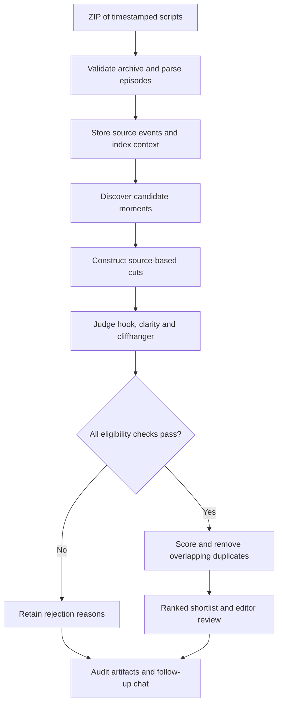
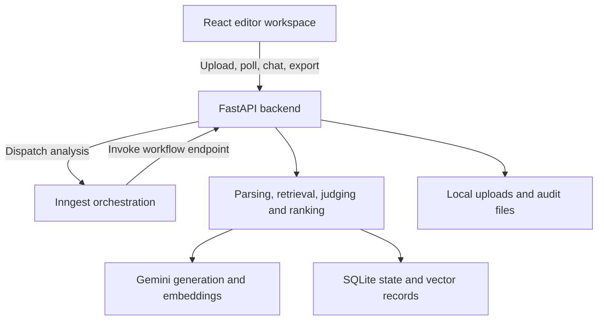

<div align="center">

# Promo Finder

### Find the moment that makes viewers want the next episode.

A screenplay-to-promo discovery workspace for microdrama editors.

**Upload scripts · Discover strong cuts · Review the evidence · Export timestamps**

React 18 · TypeScript · FastAPI · Gemini · Inngest · SQLite

[Quick start](#quick-start) · [How it works](#how-it-works) · [Local setup](#local-setup) · [API](#api) · [Validation](#validation)

</div>

---

## The product

A season of microdrama can contain hundreds of dramatic moments. Finding the few that work as standalone promos means reviewing scripts, checking context, locating hooks, and making sure the ending leaves a compelling question unanswered.

**Promo Finder turns a ZIP of timestamped episode screenplays into a ranked shortlist of up to 10 promo cuts.** Each recommendation includes source timestamps, a hook, a cliffhanger, criterion scores, and evidence that an editor can inspect before making the cut.

The output is an editorial decision aid: precise cut instructions and explanations. Video editing, rendering, and publishing remain with the editor.

## What an editor can do

| Capability | What it delivers |
| --- | --- |
| Upload a show | Submit a ZIP through the file picker or drag and drop |
| Follow the analysis | Watch parsing, episode analysis, and ranking progress |
| Review ranked cuts | Inspect duration, source segments, hooks, cliffhangers, and score breakdowns |
| Check the reasoning | Expand criterion evidence and review flags and later-answer notes |
| Understand coverage | See received, parsed, analyzed, and failed episode counts |
| Ask follow-up questions | Discuss rankings using answers grounded in stored analysis artifacts |
| Export the shortlist | Download JSON or CSV, or copy timestamps and promo summaries |
| Revisit a show | Search and rename local history entries and reload analysis URLs |
| Explore without credentials | Run a complete synthetic demo with no backend or API key |

The interface uses a dark-and-gold visual system, a chat-style workflow, responsive cards, keyboard focus indicators, and reduced-motion support.

## How it works



1. **Validate the input.** Check archive paths, file counts, sizes, and compression before processing screenplay files.
2. **Preserve the source.** Parse events with stable identifiers, episode numbers, timestamps, and filename/line provenance. Timestamp arithmetic uses integer centiseconds.
3. **Discover candidate moments.** Gemini identifies promising hooks and endings. Python constructs candidate boundaries from the parsed source events.
4. **Judge the actual cut.** The judge receives the events visible in the candidate, in playback order, rather than the entire episode or discovery explanation.
5. **Apply eligibility rules.** Validate duration, dialogue boundaries, hook timing, clarity, cliffhanger evidence, and immediate lookahead.
6. **Rank and explain.** Score eligible candidates, suppress overlapping cuts of the same ending beat, and return the shortlist with coverage and audit information.

Inngest coordinates the durable stages and retries. Successfully completed episodes can still produce results when other episodes fail.

## Ranking philosophy

**Eligibility comes first. A high score cannot rescue a cut that fails a required criterion.**

| Criterion | Weight | Editorial question |
| --- | ---: | --- |
| Hook | 40% | Does the opening establish an immediate reason to watch? |
| Cliffhanger | 35% | Does the ending leave a compelling unresolved question? |
| Clarity | 25% | Can the viewer understand the stakes within this cut? |

```text
Weighted score = 0.40 × hook + 0.35 × cliffhanger + 0.25 × clarity
```

Scores are reported out of 5. Default candidate duration is **20–60 seconds**, with a **3-second hook window**. All three criteria must pass. The system may return fewer than 10 promos; it does not lower eligibility standards to fill the list.

Where word-level timing is absent, dialogue-hook timing uses the end of the source line conservatively. Unverified timing can reject a candidate. A later answer may annotate a promo; an explicit answer in the immediate lookahead can disqualify it.

## A recommendation at a glance

The following is a **synthetic demonstration**, not a claim about real footage or measured model quality:

| Field | Example |
| --- | --- |
| Rank | #1 |
| Source cut | Ep 1 · `00:39.00 → 01:23.70` |
| Duration | 44.7 seconds |
| Hook | “The judge signed the murder order.” |
| Hook lands | 2.2 seconds into the cut |
| Cliffhanger | Why is her sister standing beside the judge? |
| Scores | Hook 5 · Cliffhanger 5 · Clarity 4 |
| Weighted score | 4.75 / 5 |

Source timestamp strings are displayed exactly as supplied by the API. The frontend formats centiseconds only when those strings are missing.

## Architecture



| Layer | Technology / responsibility |
| --- | --- |
| Frontend | React 18, strict TypeScript, Vite, Tailwind CSS v4, lucide-react |
| API | FastAPI, Pydantic, multipart uploads, typed errors |
| Orchestration | Inngest episode workflows, retries, and finalization |
| Models | Configurable Gemini generation, judging, and embedding models |
| Retrieval | Episode-scoped windows, NumPy cosine similarity, SQLite vector metadata |
| Persistence | SQLite with WAL; local filesystem for uploads and audit artifacts |
| Testing | Vitest, React Testing Library, pytest, mocked provider responses |

Follow-up chat retrieves stored analysis artifacts, including judge and rejection reasons. Returned citation identifiers are validated. It does not silently rerun the entire show analysis.

## Quick start

**Try the full interface without a backend.** Install Node.js 20.19+ and npm, extract the project, and run these commands from the `promo-finder` root:

```bash
cd frontend
npm install
npm run dev:mock
```

Open **http://localhost:5173** and click **Try the sample show**.

The frontend demo simulates 12 episodes, one failed episode, and eight ranked promos. It demonstrates progress, partial coverage, exports, history, and follow-up chat using synthetic fixtures. It does not make model requests or evaluate the uploaded text.

Stop the server with **Ctrl+C**.

## Local setup

These backend commands use Bash on Linux/macOS or WSL. You will need Python 3.10+, Node.js 20.19+, and a Google AI Studio API key for live analysis.

### 1. Install and configure the backend

From the project root:

```bash
python -m venv .venv
source .venv/bin/activate
python -m pip install -r requirements.txt
cp .env.example .env
```

Edit `.env`. Replace the model placeholders with model IDs available to your Google project:

```dotenv
GEMINI_API_KEY=your_google_api_key
GEMINI_MODEL=your_generation_model_id
GEMINI_JUDGE_MODEL=your_judging_model_id
EMBED_MODEL=your_embedding_model_id
EMBED_TASK_STYLE=task_type
MODEL_PROVIDER=gemini
MODEL_CONCURRENCY=1
DATA_DIR=./data
INNGEST_DEV=1
```

The generation and judging models may be the same. An empty `GEMINI_JUDGE_MODEL` falls back to `GEMINI_MODEL`. Choose the embedding task style appropriate to your model. Model access and quotas depend on the Google project; no model ID or unlimited free usage is assumed.

The backend reads the process environment, so load the file before starting it:

```bash
set -a
source .env
set +a
uvicorn backend.app:app --reload --port 8000
```

### 2. Start the local Inngest server

In a second terminal:

```bash
npx --ignore-scripts=false inngest-cli@latest dev -u http://localhost:8000/api/inngest
```

This command runs the CLI without a global installation. Accept the installation prompt if shown. Keep this terminal running: API uploads need the workflow server to complete.

### 3. Start the frontend

In a third terminal, from the project root:

```bash
cd frontend
npm install
npm run dev
```

Defaults connect to `http://localhost:8000` with mock mode disabled. For custom settings, copy `frontend/.env.example` to `frontend/.env.local` and set:

```dotenv
VITE_API_BASE_URL=http://localhost:8000
VITE_MAX_UPLOAD_MB=25
VITE_USE_MOCK=0
```

Restart Vite after changing environment values. Remove stale mock-mode overrides from `.env.local` or your shell when switching modes.

| Local service | URL |
| --- | --- |
| Frontend | http://localhost:5173 |
| API documentation | http://localhost:8000/docs |
| Health check | http://localhost:8000/health |
| Inngest dashboard | http://localhost:8288 |
| Inngest app endpoint | http://localhost:8000/api/inngest |

Both root and frontend `.env.example` files are included. They serve different purposes. API keys belong only in the backend environment; every `VITE_*` value is public browser configuration.

### Optional: run without Inngest

With the backend environment loaded, the command-line pipeline can process a ZIP directly:

```bash
python examples/make_synthetic.py
python -m backend.run --zip examples/synthetic-show.zip --out outputs --no-inngest
```

This still uses the configured live models. For a deterministic backend demonstration without provider calls:

```bash
python -m examples.offline_demo
```

## Inputs and exports

Input is a ZIP containing episode text screenplays with the supported episode headers, block labels, and source timestamps. Use the generated synthetic ZIP as a format reference. Arbitrary prose, PDFs, and video files are not supported inputs.

The bundled generator produces **three synthetic episodes**. The frontend mock's 12-episode run is a separate fixture and deliberately does not represent that ZIP's actual file count.

| Artifact | Contents |
| --- | --- |
| `promos.json` | Ranked cuts, segments, scores, evidence, and flags |
| `promos.csv` | One row per segment, grouped by promo rank |
| `rejected.json` | Rejected candidates and their reasons |
| `run_report.json` | Coverage, failures, model usage, and runtime |
| `raw/` | Provider responses and per-call metadata for audit |

The CLI writes these artifacts to its output directory. The UI exposes result JSON/CSV downloads and text copying. Raw audit files are not exposed as a public download endpoint.

## API

| Method | Endpoint | Purpose |
| --- | --- | --- |
| GET | `/health` | Process health |
| POST | `/analyses` | Upload ZIP as multipart field `file`; returns `analysis_id` |
| GET | `/analyses/{id}` | Progress, status, counts, and errors |
| GET | `/analyses/{id}/results` | Shortlist, run report, and rejected candidates |
| GET | `/analyses/{id}/results?format=csv` | CSV export |
| POST | `/analyses/{id}/chat` | Artifact-grounded follow-up answer |
| SDK-managed | `/api/inngest` | Workflow registration and execution |

```bash
curl -F 'file=@examples/synthetic-show.zip' http://localhost:8000/analyses
```

The frontend polls status every 1.5 seconds, backs off after network errors, and stops at terminal states. Optional history-list and chat support degrade gracefully against compatible servers. The bundled backend has no list-analyses endpoint; history is maintained locally in the browser.

## Repository guide

| Path | Responsibility |
| --- | --- |
| `frontend/src/components/` | Workspace, chat, upload, progress, and promo cards |
| `frontend/src/api/` | Fetch client, normalization, types, and mock transport |
| `frontend/src/hooks/` | Analysis polling, health, and history |
| `frontend/src/styles/` | Design tokens and responsive styles |
| `frontend/tests/` | UI and client behavior tests |
| `backend/ingest.py` | Archive checks and screenplay parsing |
| `backend/pipeline.py` | Candidate construction, eligibility, and ranking |
| `backend/model.py` | Model adapters, retries, and response logging |
| `backend/rag.py` | Retrieval, embedding cache, and grounded chat |
| `backend/store.py` | SQLite persistence |
| `backend/workflows.py` | Inngest orchestration |
| `backend/app.py` | HTTP API |
| `backend/run.py` | Command-line analysis and exports |
| `examples/` | Synthetic generator and deterministic demo |
| `tests/` | Backend tests |

## Validation

The delivered build recorded these results on **7 November 2026**:

| Check | Recorded result |
| --- | --- |
| Backend pytest suite | 31 passed; 2 optional source-dependent tests skipped |
| Frontend Vitest suite | 39 passed across 7 files |
| Frontend production build | Strict TypeScript and Vite build passed |
| Browser inspection | Desktop and 360px layout; synthetic upload, partial results, and follow-up chat |

```bash
# From the project root
python -m pytest -q

# From frontend/
npm test
npm run build
```

Tests cover source timestamps, parsing, eligibility, judge isolation, retrieval scoping, caching, workflow replay, API errors, polling, normalization, upload validation, history, and mock UI flows.

These are implementation checks, not an editorial quality benchmark. Live Gemini generation/embeddings and a credentialed end-to-end Inngest run were not verified during delivery. See [VALIDATION.md](VALIDATION.md) for details.

## Deployment

Deploy the frontend as a static Vite build and the backend as a Python web service. Configure an SPA fallback to `index.html` so `/a/:analysisId` URLs survive reloads.

For a hosted backend:

- Start with `uvicorn backend.app:app --host 0.0.0.0 --port $PORT` on hosts that provide `PORT`.
- Set model credentials and `INNGEST_EVENT_KEY` / `INNGEST_SIGNING_KEY` as server-side secrets.
- Remove `INNGEST_DEV`, then sync the deployed `/api/inngest` endpoint in Inngest Cloud.
- Add the exact deployed frontend origin to `allow_origins` in `backend/app.py`.
- Set `VITE_API_BASE_URL` to the backend HTTPS URL and `VITE_USE_MOCK=0` before building the frontend.
- Keep the database, uploads, and worker-visible data on durable shared storage appropriate to the deployment.

The current implementation targets one backend host. Ephemeral hosting can erase SQLite data and uploads during restarts. A multi-host deployment requires a storage migration, such as PostgreSQL plus object storage; an environment-variable change alone is insufficient. Add authentication and authorization before opening the API to public users.

## Assumptions and limits

- Screenplay timestamps describe the intended source; actual footage, delivery, music, and pacing require human review.
- No word-level timing is invented. Conservative timing checks may reject an otherwise usable promo.
- No minimum shortlist size is guaranteed. A show may contain fewer than eight eligible cuts, or none.
- Full-episode discovery is bounded by the selected model's context window. Very long episodes may fail explicitly.
- Later-answer retrieval depends on indexed material and may miss a resolution.
- Two-segment context repair is optional and disabled by default.
- Browser history and editor names are local. Follow-up messages and original ZIP bytes do not persist in browser history after reload.
- Authentication, user tenancy, cross-device history sync, video editing, and publishing are not implemented.
- Gemini is the working model adapter; the OpenAI-compatible adapter is a marked stub.
- The frontend includes a lockfile. Backend dependency ranges should be pinned and revalidated for reproducible deployment.

## Troubleshooting

| Symptom | First check |
| --- | --- |
| `inngest: command not found` | Use the `npx ... inngest-cli@latest` command above |
| Can't reach the server | Start FastAPI; verify the API base URL and allowed frontend origin |
| Upload remains pending | Confirm Inngest is running and the app endpoint has synced |
| Demo results appear for every ZIP | Set `VITE_USE_MOCK=0` and restart the frontend |
| Provider returns quota errors | Check project/model quotas; begin with a small ZIP and lower concurrency |
| History item stops loading after deploy | Check whether backend storage was lost during a restart |
| Port 5173 is occupied | Stop the existing frontend process and restart |

## Further reading

- [Frontend guide](frontend/README.md)
- [Beginner setup](START_HERE.md)
- [Validation record](VALIDATION.md)
- [Google AI Studio](https://aistudio.google.com/)
- [Inngest Python documentation](https://www.inngest.com/docs/reference/python)

---

**A strong promo starts with the right moment. Promo Finder helps editors find it—and understand why it belongs on the shortlist.**
